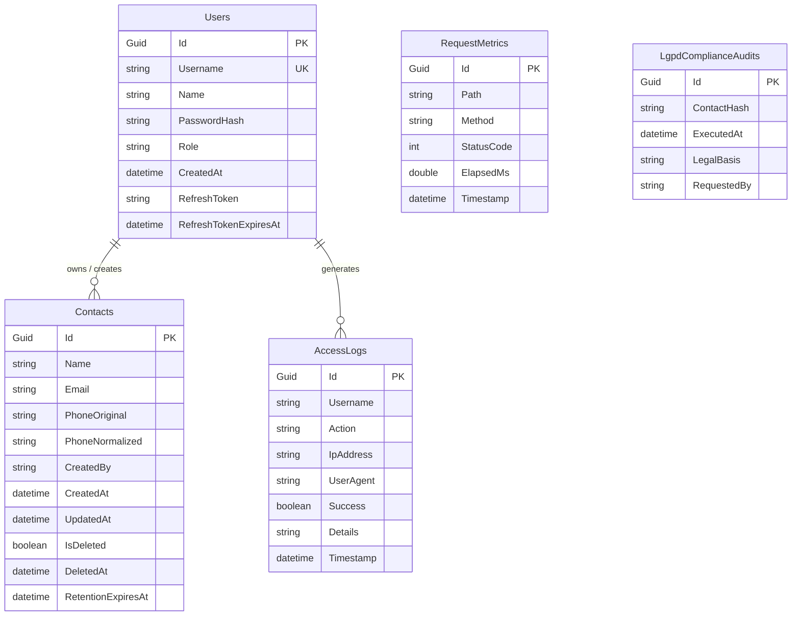

# 04 — Modelo de Dados e Persistência

## 1. Esquema Relacional de Entidades

O banco de dados do NeoAgenda é estruturado em 5 tabelas relacionais geridas pelo Entity Framework Core:



---

## 2. Detalhamento das Tabelas

### 2.1 Tabela `Contacts`
| Coluna | Tipo | Nulo? | Descrição |
| :--- | :--- | :--- | :--- |
| `Id` | `UUID` (Guid) | NÃO | Chave primária. |
| `Name` | `VARCHAR(150)` | NÃO | Nome do contato. |
| `Email` | `VARCHAR(254)` | NÃO | E-mail do contato. |
| `PhoneOriginal` | `VARCHAR(30)` | NÃO | Telefone conforme digitado pelo usuário. |
| `PhoneNormalized` | `VARCHAR(20)` | NÃO | Telefone normalizado no formato canônico E.164. |
| `CreatedBy` | `VARCHAR(100)` | NÃO | Username do proprietário da agenda (padrão: "system"). |
| `CreatedAt` | `TIMESTAMPTZ` | NÃO | Data/hora UTC de criação. |
| `UpdatedAt` | `TIMESTAMPTZ` | SIM | Data/hora UTC da última alteração. |
| `IsDeleted` | `BOOLEAN` | NÃO | Flag de soft delete (padrão: `FALSE`). |
| `DeletedAt` | `TIMESTAMPTZ` | SIM | Data/hora UTC da exclusão temporária. |
| `RetentionExpiresAt` | `TIMESTAMPTZ` | SIM | Prazo máximo de 30 dias para restauração. |

### 2.2 Tabela `Users`
| Coluna | Tipo | Nulo? | Descrição |
| :--- | :--- | :--- | :--- |
| `Id` | `UUID` (Guid) | NÃO | Identificador do usuário. |
| `Username` | `VARCHAR(50)` | NÃO | Nome de usuário único para login (ex: `admin`, `helisson.araujo`). |
| `Name` | `VARCHAR(100)` | NÃO | Nome completo de exibição. |
| `PasswordHash` | `VARCHAR(256)` | NÃO | Hash SHA-256 da senha. |
| `Role` | `VARCHAR(30)` | NÃO | Perfil de permissão (`Admin` ou `Usuario`). |
| `CreatedAt` | `TIMESTAMPTZ` | NÃO | Data de criação da conta. |
| `RefreshToken` | `VARCHAR(128)` | SIM | Token para renovação automática de sessão JWT. |
| `RefreshTokenExpiresAt` | `TIMESTAMPTZ` | SIM | Validade do refresh token (7 dias). |

### 2.3 Tabela `AccessLogs`
| Coluna | Tipo | Nulo? | Descrição |
| :--- | :--- | :--- | :--- |
| `Id` | `UUID` (Guid) | NÃO | Chave primária do evento de acesso. |
| `Username` | `VARCHAR(50)` | NÃO | Usuário envolvido na tentativa de acesso. |
| `Action` | `VARCHAR(50)` | NÃO | Ex: `LOGIN_SUCCESS`, `LOGIN_FAILED`. |
| `IpAddress` | `VARCHAR(45)` | NÃO | Endereço IP de origem da requisição. |
| `UserAgent` | `VARCHAR(255)` | SIM | Dados de navegador e dispositivo. |
| `Success` | `BOOLEAN` | NÃO | Indicador de êxito da tentativa. |
| `Details` | `VARCHAR(255)` | SIM | Mensagem contextual ou motivo da falha. |
| `Timestamp` | `TIMESTAMPTZ` | NÃO | Data e hora UTC do evento. |

### 2.4 Tabela `RequestMetrics`
| Coluna | Tipo | Nulo? | Descrição |
| :--- | :--- | :--- | :--- |
| `Id` | `UUID` (Guid) | NÃO | Identificador da métrica de requisição. |
| `Path` | `VARCHAR(150)` | NÃO | Rota acessada (ex: `/api/contacts`). |
| `Method` | `VARCHAR(10)` | NÃO | Verbo HTTP (`GET`, `POST`, `PUT`, `DELETE`). |
| `StatusCode` | `INTEGER` | NÃO | Código HTTP de retorno. |
| `ElapsedMs` | `DOUBLE PRECISION`| NÃO | Duração total do processamento em milissegundos. |
| `Timestamp` | `TIMESTAMPTZ` | NÃO | Timestamp UTC da requisição. |

### 2.5 Tabela `LgpdComplianceAudits`
| Coluna | Tipo | Nulo? | Descrição |
| :--- | :--- | :--- | :--- |
| `Id` | `UUID` (Guid) | NÃO | Chave primária do protocolo LGPD. |
| `ContactHash` | `VARCHAR(64)` | NÃO | Hash SHA-256 anônimo (`PhoneNormalized + ContactId`). |
| `ExecutedAt` | `TIMESTAMPTZ` | NÃO | Momento da exclusão irreversível. |
| `LegalBasis` | `VARCHAR(100)` | NÃO | Artigo 18, VI da Lei 13.709/2018. |
| `RequestedBy` | `VARCHAR(100)` | NÃO | Usuário solicitante da exclusão. |

---

## 3. Estratégia de Índices e Performance

1. **Filtered Unique Index de Telefone:**
   ```sql
   CREATE UNIQUE INDEX "IX_Contacts_PhoneNormalized" 
   ON "Contacts" ("PhoneNormalized") 
   WHERE "IsDeleted" = false;
   ```
2. **Índice de Usuário Único:**
   ```sql
   CREATE UNIQUE INDEX "IX_Users_Username" 
   ON "Users" ("Username");
   ```
3. **Índice de Telemetria e Logs:**
   - Índice em `AccessLogs.Timestamp` e `AccessLogs.Username` para consultas rápidas de auditoria.
   - Índice em `RequestMetrics.Timestamp` para consolidação ágil de métricas de APM.
