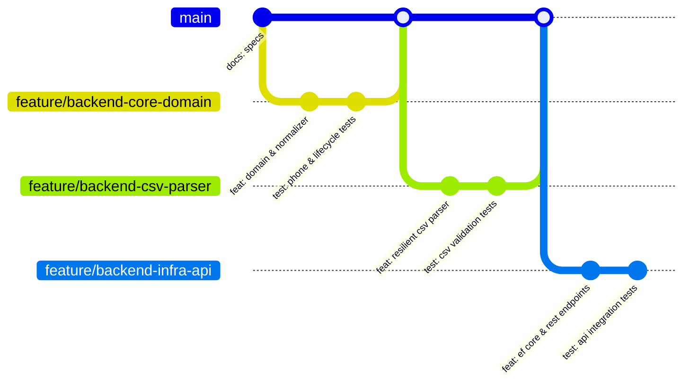

# 09 — Roadmap de Implementação e Fluxo Git

Este documento estabelece o **Roadmap Oficial** de construção do NeoAgenda, dividido em etapas modulares.
Em conformidade com as boas práticas de Engenharia de Software e **Git Flow**, cada entrega funcional é desenvolvida em uma branch temática (`feature/...`), permitindo revisão isolada e abertura de Pull Requests (PR) para a branch `main`.

---

## 🗺️ Mapa de Fases e Branches

---

## 📋 Detalhamento das Etapas

### Etapa 1: Núcleo de Domínio, Normalização e Testes de Regra
- **Branch:** `feature/backend-core-domain`
- **Escopo:**
  - Estrutura da Solution .NET (`NeoAgenda.sln`, `NeoAgenda.Domain`, `NeoAgenda.Application`).
  - Entidade `Contact` rica com ciclo de vida de Soft Delete (30 dias) e validação de regras.
  - Serviço canônico de normalização de telefone (`PhoneNormalizer`) cobrindo padrão nacional (E.164, DDDs, 8/9 dígitos, pontuações, DDI +55).
  - Entidade `LgpdComplianceAudit`.
  - Interfaces de repositório e DTOs essenciais.
  - Suíte de Testes Unitários (`NeoAgenda.UnitTests`) cobrindo todas as variações de formato e regras de ciclo de vida.
- **Entregável:** PR para revisão com suíte de testes unitários verdes.

---

### Etapa 2: Motor de Importação CSV Resiliente
- **Branch:** `feature/backend-csv-parser`
- **Escopo:**
  - Implementação do `CsvContactParser` com `CsvHelper`.
  - Mapeamento dinâmico de cabeçalhos (`nome`, `email`, `telefone` e sinônimos).
  - Suporte a delimitadores múltiplos (`,`, `;`).
  - Validação linha a linha tolerante a falhas (linhas válidas são aceitas; inconsistências são catalogadas).
  - Prevenção de duplicidades no próprio lote CSV.
  - Testes unitários para múltiplos cenários de CSVs imperfeitos.
- **Entregável:** PR para revisão com relatório detalhado de importação.

---

### Etapa 3: Persistência, EF Core e API RESTful
- **Branch:** `feature/backend-infra-api`
- **Escopo:**
  - Projeto `NeoAgenda.Infrastructure` com `AppDbContext`.
  - Configuração de Filtered Unique Index no banco de dados (`PhoneNormalized` único onde `IsDeleted = false`).
  - Projeto `NeoAgenda.Api` com endpoints REST:
    - `GET /api/contacts` (paginado, busca, filtros)
    - `POST /api/contacts`
    - `PUT /api/contacts/{id}`
    - `DELETE /api/contacts/{id}` (Soft Delete)
    - `POST /api/contacts/{id}/restore`
    - `DELETE /api/contacts/{id}/lgpd` (Hard Delete irreversível)
    - `GET /api/contacts/recycle-bin`
    - `POST /api/contacts/import-csv`
    - `GET /api/contacts/export-csv`
  - Middleware RFC 7807 (ProblemDetails) e Swagger OpenAPI documentado.
  - Testes de Integração com `WebApplicationFactory`.
- **Entregável:** PR para revisão com API completa testável via Swagger.

---

### Etapa 4: Frontend Base Vue 3 + PrimeVue
- **Branch:** `feature/frontend-scaffold-primevue`
- **Escopo:**
  - Setup do projeto Vue 3 com Vite, TypeScript, PrimeVue (tema moderno) e Pinia.
  - Layout da aplicação com Navbar, indicador de conectividade e área de notificações (Toast).
  - Cliente HTTP Axios configurado com tratamento global de erros.
- **Entregável:** PR para revisão da casca visual da aplicação.

---

### Etapa 5: Gestão de Contatos, Busca e Formulários
- **Branch:** `feature/frontend-contact-management`
- **Escopo:**
  - Tabela reativa com `PrimeVue DataTable` (ordenação, paginação, busca rápida).
  - Modal/Drawer de criação e edição com máscara inteligente de telefone.
  - Integração em tempo real com a API e exibição de feedback via Toasts.
- **Entregável:** PR para revisão do CRUD completo de contatos.

---

### Etapa 6: Lixeira (30 Dias) e Conformidade LGPD
- **Branch:** `feature/frontend-recycle-bin-and-lgpd`
- **Escopo:**
  - Visão da Lixeira com contagem regressiva de dias restantes para expiração do contato.
  - Ação de Restauração com tratamento de eventual conflito de telefone.
  - Modal de Exclusão Definitiva LGPD com aviso legal de irreversibilidade e checkbox obrigatório de consentimento.
- **Entregável:** PR para revisão dos fluxos de privacidade e ciclo de vida.

---

### Etapa 7: Importação CSV com Relatório Visual de Erros
- **Branch:** `feature/frontend-csv-import`
- **Escopo:**
  - Componente de upload Drag & Drop (`FileUpload`).
  - Painel de resultado da importação: total importado vs total de erros.
  - Visualizador detalhado de linhas rejeitadas com motivo explícito e botão de download do relatório de correções.
- **Entregável:** PR para revisão da interface de importação resiliente.

---

### Etapa 8: Docker, Orquestração e Documentação Final
- **Branch:** `feature/docker-and-docs`
- **Escopo:**
  - `Dockerfile` multi-stage para backend (.NET) e frontend (Nginx).
  - `docker-compose.yml` para subida com 1 comando.
  - README.md completo contemplando:
    - Como rodar (Docker);
    - Decisões de design e trade-offs;
    - O que foi deixado de fora e por quê;
    - Uso transparente de IA (o que aceitou, corrigiu e rejeitou);
    - Tempo total investido.
- **Entregável:** PR final com aplicação 100% conteinerizada e documentada.
